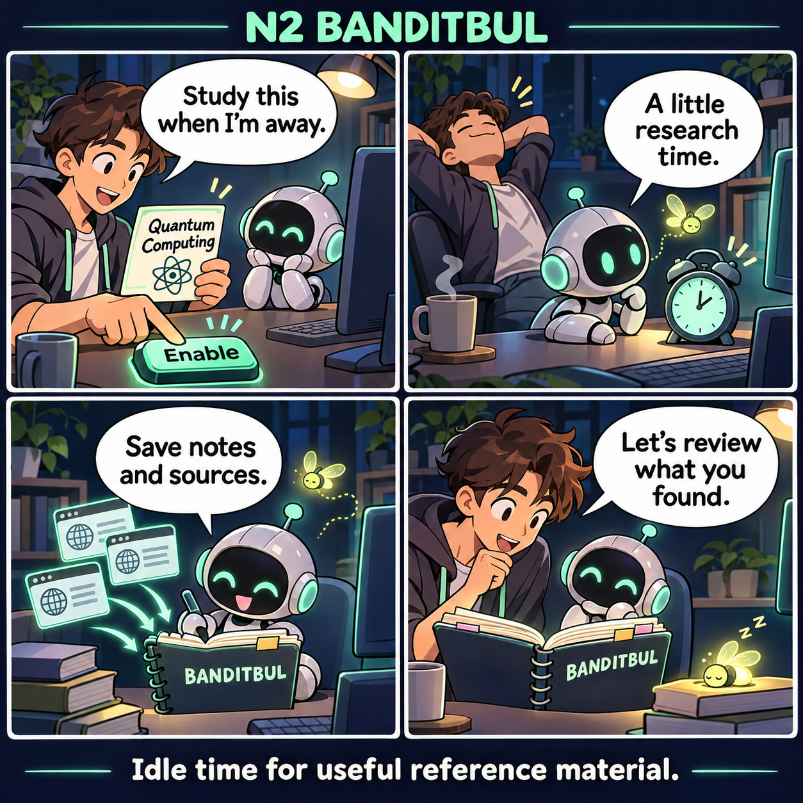
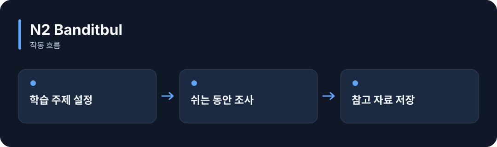

# N2 Banditbul

**AI가 쉬는 동안 정해 둔 주제를 조사하고, 나중에 참고할 내용을 출처와 함께 저장합니다.**

[](https://github.com/choihyunsus/n2-banditbul/releases/tag/v1.0.0) [](https://github.com/choihyunsus/n2-banditbul/blob/main/docs/reference.ko.md) [](https://github.com/choihyunsus/n2-banditbul/blob/main/LICENSE)

[English](README.md)

<p align="center">
  
</p>

사용자가 주제를 정하고 실행을 켭니다. 쉬는 동안 자료와 출처를 모아 두고, 돌아오면 내용을 검토합니다.

기능을 이야기로 표현한 만화입니다. 실제 앱 화면은 아닙니다.

<details>
<summary>동작 흐름 펼쳐 보기</summary>



</details>

## 이런 때 사용하세요

관심 있는 기술이나 업무 주제를 정해 두고, 사용자가 작업하지 않는 시간에 자료를 쌓는 비서를 만들 때 활용하세요.

앱이 사용자 활동을 알려주고 실행 프로세스를 유지해야 합니다. 새 설정은 일시정지 상태로 시작하며, 조사 내용은 검토할 자료로 저장됩니다.

## 처음 실행하기

터미널에서 `node --version`을 실행해 Node.js 22 이상인지 확인하세요. 아래 명령은 새 연습 폴더를 만들고 GitHub 배포 파일을 설치합니다. 예제 파일과 DB도 이 폴더에 두면 경로를 따라가기 쉽습니다.

```sh
mkdir n2-banditbul-demo
cd n2-banditbul-demo
npm init -y
npm install https://github.com/choihyunsus/n2-banditbul/releases/download/v1.0.0/n2-banditbul-1.0.0.tgz
```

설치 중 SQLite 빌드 오류가 나오면 운영체제에 맞는 C/C++ 빌드 도구가 필요할 수 있습니다. 자세한 환경 조건은 [설치 참고](https://github.com/choihyunsus/n2-banditbul/blob/main/docs/reference.ko.md)에 있습니다.

아래 내용을 `demo.mjs`로 저장하세요. 파일은 방금 설치 명령을 실행한 폴더에 둡니다.

```js
import { Banditbul } from 'n2-banditbul';
const learner = new Banditbul({
  dbPath: './demo.db', project: 'demo', agent: 'assistant',
});
try {
  learner.configure({
    study_topics: [{ category: 'programming', queries: ['TypeScript error handling'] }],
  });
  console.log(learner.status().paused);
  console.log(learner.status().config.study_topics);
} finally {
  await learner.close();
}
```

```sh
node demo.mjs
```

`true`와 등록한 주제가 출력됩니다. 주제 저장을 확인한 뒤 앱에서 `resume()`과 `start()`를 호출하면 유휴 시간에 조사합니다. 사용자 활동 때 `touch()`, 종료 때 `close()`를 연결하세요.

## Soul과 함께 쓰기

여러 N2 모듈을 연결할 때 같은 `mimir.db` 파일을 지정하세요. `project`는 작업 이름, `agent`는 계속 사용할 AI 이름입니다. 같은 작업의 기록을 이어 쓰려면 이 값들을 맞춥니다. 단독 사용도 같은 필드 구조를 사용합니다.

## 다음 단계와 상세 안내

[전체 사용 안내](https://github.com/choihyunsus/n2-banditbul/blob/main/docs/reference.ko.md)에서 실제 앱 연결, API, 지원 범위, 복구 절차와 검증 범위를 확인할 수 있습니다. [배포 파일](https://github.com/choihyunsus/n2-banditbul/releases/tag/v1.0.0)에는 설치할 버전과 변경 설명이 있습니다.

처음 나오는 용어는 이렇게 읽으면 됩니다. **MCP**는 AI 앱의 도구 연결 방식, **DB**는 저장 파일, **호스트**는 이 모듈을 연결해 실행하는 앱입니다.

사용·재배포 조건은 [라이선스](https://github.com/choihyunsus/n2-banditbul/blob/main/LICENSE)를 확인하세요. 의존 모듈에는 별도 조건이 적용될 수 있으며, 상업 이용 조건은 상세 안내에 함께 설명되어 있습니다.
