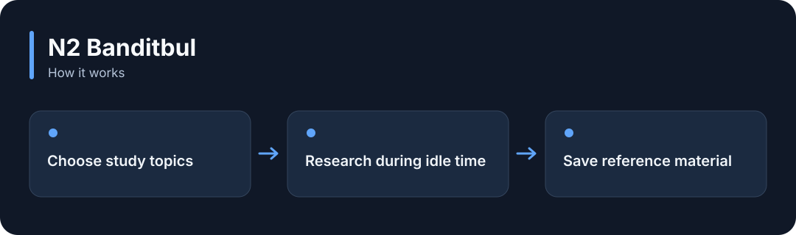

# N2 Banditbul

**Research selected topics while an AI is idle and save material with sources for future work.**

[](https://github.com/choihyunsus/n2-banditbul/releases/tag/v1.0.0) [](https://github.com/choihyunsus/n2-banditbul/blob/main/docs/reference.md) [](https://github.com/choihyunsus/n2-banditbul/blob/main/LICENSE)

[한국어](README.ko.md)



## When to use it

Build an assistant that collects material about selected technical or work topics during idle time.

The app must report user activity and keep the process running. New scopes start paused, and research is stored as material to review.

## Try it

Run `node --version` in a terminal and check for Node.js 22 or later. These commands create a fresh practice folder and install the GitHub release. Keep the example file and database in this folder.

```sh
mkdir n2-banditbul-demo
cd n2-banditbul-demo
npm init -y
npm install https://github.com/choihyunsus/n2-banditbul/releases/download/v1.0.0/n2-banditbul-1.0.0.tgz
```

If installation reports a SQLite build error, you may need your platform’s C/C++ build tools. See the [installation reference](https://github.com/choihyunsus/n2-banditbul/blob/main/docs/reference.md) for platform requirements.

Save the following as `demo.mjs` in the folder where you ran the install command.

```js
import { Banditbul } from 'n2-banditbul';
const learner = new Banditbul({
  dbPath: './demo.db', project: 'demo', agent: 'assistant',
});
try {
  learner.configure({
    study_topics: [{ category: 'programming', queries: ['TypeScript error handling'] }],
  });
  console.log(learner.status().paused);
  console.log(learner.status().config.study_topics);
} finally {
  await learner.close();
}
```

```sh
node demo.mjs
```

`true` and the configured topic appear. After checking the saved setup, call `resume()` and `start()` in a running app to research during idle time. Connect user activity to `touch()` and shutdown to `close()`.

## Using it with Soul

Point connected N2 modules at the same `mimir.db` file. `project` names the work and `agent` names the AI identity you will keep using. Match those values to continue working with the same records. Standalone use follows the same field layout.

## Next steps and reference

The [full reference](https://github.com/choihyunsus/n2-banditbul/blob/main/docs/reference.md) covers app integration, APIs, supported features, recovery and validation. The [release page](https://github.com/choihyunsus/n2-banditbul/releases/tag/v1.0.0) contains the installable version and release notes.

A few terms used in the reference: **MCP** connects tools to an AI app, a **database** stores records, and the **host** is the app that connects and runs this module.

Review the [license](https://github.com/choihyunsus/n2-banditbul/blob/main/LICENSE) for use and redistribution. Dependencies can have their own terms, including commercial-use conditions described in the reference.
